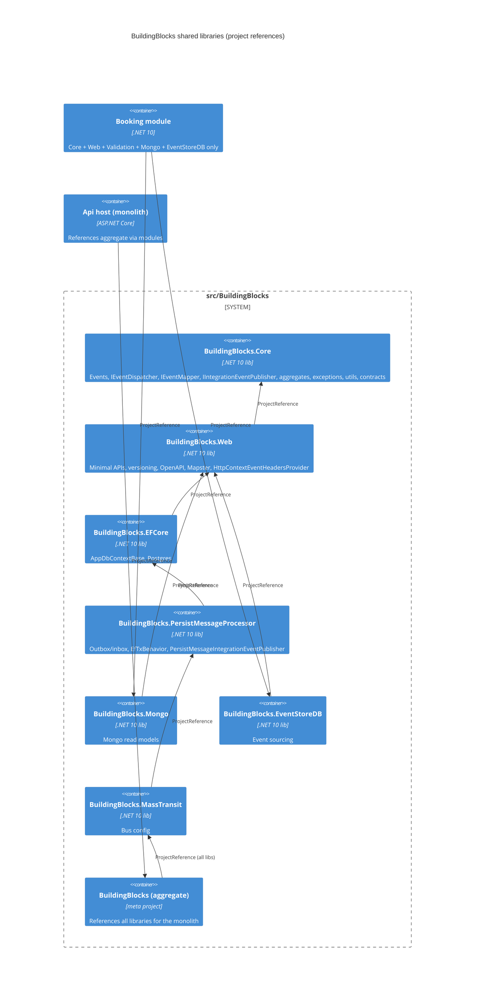

# 0500. Split BuildingBlocks into independently consumable shared libraries

- **Status:** Proposed
- **Date:** 2026-10-13
- **ARB ticket:** TO BE CREATED
- **Authors:** Devin (AB-500)
- **Owning team:** booking-modular-monolith maintainers (TBD — owner to confirm before ARB)
- **Related ADRs:** none yet (epic AB-488 "Microservices Migration Scaffolding")

## Context

`src/BuildingBlocks/BuildingBlocks.csproj` is a single assembly that pulls in EF Core, MongoDB,
EventStoreDB, MassTransit/RabbitMQ, gRPC, Duende IdentityServer, YARP, OpenTelemetry and test
tooling. Every module (and every future per-module service host from AB-488) therefore inherits all
of those dependencies. The `EventDispatcher` also hard-depended on `IPersistMessageProcessor` (EF
Core outbox) and `IHttpContextAccessor`, and the Api host had to hand-compose one
`CompositeEventMapper` over all four module mappers, so a single service could not register only its
own mapper.

Constraints: sibling tickets (AB-501, AB-492, AB-494, AB-506) edit files under
`src/BuildingBlocks/**` concurrently, so the split must be done in place (no file moves, no namespace
changes) and the monolith must keep building and passing tests.

ARB triggers: T8 (new shared library/platform component — 13 packable `BuildingBlocks.*` libraries
plus a local NuGet feed). T1 heuristic hit on `src/Api/Dockerfile` is a false positive (it only
copies the new csproj files before `dotnet restore`; no new container or deployment).

## Decision

We will give each BuildingBlocks folder its own SDK project in place
(`src/BuildingBlocks/<Area>/BuildingBlocks.<Area>.csproj`: Core, Web, Validation, ProblemDetails,
EFCore, PersistMessageProcessor, Mongo, EventStoreDB, MassTransit, Jwt, HealthCheck,
OpenTelemetryCollector, TestBase) with an explicit dependency surface, keep
`src/BuildingBlocks/BuildingBlocks.csproj` as a thin compile-less aggregate referencing all of them,
decouple `EventDispatcher` through `IIntegrationEventPublisher` / `IEventHeadersProvider` and
`IEnumerable<IEventMapper>` (registered via `AddEventDispatcher()` / `AddEventMapper<T>()`), and
pack every library as SemVer `1.0.0` into the local feed `./artifacts/packages` via
`scripts/pack.sh`.

## Alternatives considered

| Alternative | Pros | Cons | Why rejected |
| --- | --- | --- | --- |
| Do nothing | No churn | Every service ships EF Core/IdentityServer/YARP/etc.; services cannot register only their own mappers | Blocks the AB-488 per-service hosts |
| Move sources into new `src/BuildingBlocks.<Area>/` folders (earlier AB-233 attempt) | Clean physical layout | Moves/renames hundreds of files that sibling tickets are editing right now → unmergeable | Parallel-merge risk |
| Publish to a remote feed (GitHub Packages / Azure Artifacts) | Shareable across repos | New external dependency, credentials, CI secrets | Not needed while all consumers live in this repo; can follow later |

## Architecture

Validation, ProblemDetails → Core; Jwt, OpenTelemetryCollector → Core + Web;
HealthCheck → EFCore + EventStoreDB + MassTransit + Mongo + Web; TestBase → Core + EFCore + Mongo +
PersistMessageProcessor + Web.

## Non-functional requirements

| NFR | Target | How met |
| --- | --- | --- |
| Availability SLO | N/A — build-time change | Runtime behaviour unchanged |
| p95 latency | N/A | No runtime path added (dispatcher composes mappers in-process as before) |
| RPO / RTO | N/A | No data store change |
| Peak load | N/A | — |
| Scaling model | N/A | Enables per-service deployment later |
| Data retention | N/A | — |

## Security & compliance

- **Data classification:** N/A — no new data.
- **Encryption at rest / in transit:** unchanged.
- **AuthN / AuthZ:** unchanged; the `ApiScope` policy name moved to `IdentityConstant.Policy.ApiScope` (same value) so Jwt/Booking no longer need Duende EF entities.
- **Secrets:** none; local feed needs no credentials.
- **Audit logging:** unchanged (event headers CorrelationId/UserId/UserName preserved via `HttpContextEventHeadersProvider`).
- **Data residency / regions:** N/A.
- **Policy sections satisfied:** no infrastructure; no new external dependency (all packages already used by the aggregate).
- **Threats considered:** dependency confusion on the local feed — `nuget.config` uses `packageSourceMapping` so only `BuildingBlocks*` IDs may resolve from `./artifacts/packages`.

## Cost

| Item | Assumption | Monthly estimate |
| --- | --- | --- |
| None | Local feed on disk / CI workspace | $0 |
| **Total** | | $0 |

## Operations

- **On-call rotation:** N/A (library change).
- **Runbook:** `scripts/pack.sh [--version X.Y.Z]` packs every library into `./artifacts/packages`.
- **Dashboards / alarms:** N/A.
- **Rollback plan:** revert the PR; the aggregate project keeps the old reference shape for all consumers.
- **Migration / cut-over plan:** modules can switch from the aggregate to minimal references one at a time (Booking already does).

## Policy exceptions requested

| Rule | Resource | Justification | Compensating control | Expiry |
| --- | --- | --- | --- | --- |
| none | | | | |

## Consequences

- Positive: services reference only what they need (Booking builds with no EF Core in its graph); a single service registers only its own mappers; libraries pack/version independently.
- Negative / risks: `BuildingBlocks.MassTransit` still depends on PersistMessageProcessor (EF Core) for its inbox filter; Core still carries `MassTransit` (NewId) and the shared contracts until AB-506 moves them out.
- Follow-ups: abstract the MassTransit inbox store (AB-501/AB-492); move contracts out of Core (AB-506); remote feed publishing if packages are consumed outside this repo.

## Open questions

- Owning team / reviewers for shared-library versioning policy (TBD — owner to confirm before ARB).
