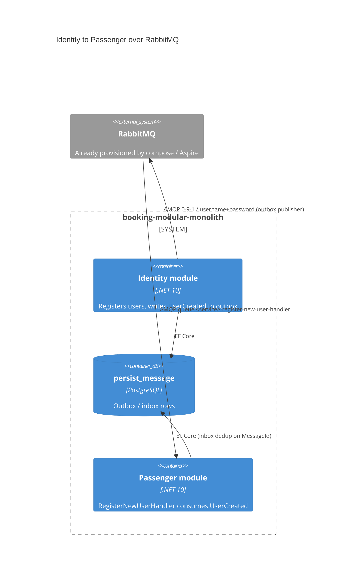

# 0501. RabbitMQ as the MassTransit transport for cross-module events

- **Status:** Proposed
- **Date:** 2026-10-13
- **ARB ticket:** TO BE CREATED
- **Authors:** Devin (AB-501)
- **Owning team:** TBD — owner to confirm before ARB
- **Related ADRs:** none yet (part of epic AB-488, microservices migration scaffolding)

## Context

The monolith (`src/Api`) hard-coded `TransportType.InMemory` and registered consumers by scanning
every loaded assembly, so integration events such as Identity `UserCreated` never left the process.
Extracting Identity, Flight, Passenger and Booking into separate services (AB-488) needs a real
broker. RabbitMQ is already provisioned by docker-compose and Aspire but unused.

ARB triggers: T4 (the existing `UserCreated` contract between the Identity and Passenger bounded
contexts can now travel over broker exchanges/queues instead of in-process). The contract itself
is unchanged. No new data store, vendor, deployable, or auth/network boundary is introduced.

## Decision

We will select the MassTransit transport from a `MessageBroker` configuration section
(`TransportType` = `InMemory` | `RabbitMq`, `ServiceName`, `UseInbox`,
`RabbitMq:{Host,Port,VirtualHost,Username,Password}`; Aspire's `ConnectionStrings:rabbitmq` wins
when present). Receive endpoints are named `<ServiceName>-<consumer>` and consumers are registered
only from explicit module assemblies. The outbox publishes through the configured bus with the
outbox row id as the MassTransit `MessageId`, and the inbox consume filter deduplicates on
`MessageId` scoped to the receiving endpoint. The monolith keeps `InMemory` by default; the docker
and Aspire profiles switch it to `RabbitMq`.

## Alternatives considered

| Alternative | Pros | Cons | Why rejected |
| --- | --- | --- | --- |
| Do nothing (in-memory only) | No new runtime dependency | Services cannot exchange events | Blocks AB-488 |
| Always RabbitMQ, no InMemory | One code path | Unit tests and local runs need a broker | Epic keeps InMemory for tests/monolith |
| Separate transport per module | Isolation | Extra config, no benefit while in one process | Per-service naming gives isolation later |

## Architecture

## Non-functional requirements

| NFR | Target | How met |
| --- | --- | --- |
| Availability SLO | TBD — owner to confirm before ARB | Outbox buffers events while the broker is down |
| p95 latency | TBD | Bounded by `PersistMessageOptions:Interval` (30 s default) |
| RPO / RTO | No event loss once committed to outbox | Outbox + at-least-once delivery + inbox dedup |
| Peak load | TBD | Single RabbitMQ node today |
| Scaling model | Competing consumers per service queue | Per-service endpoint names |
| Data retention | Persist-message rows as today | Unchanged |

## Security & compliance

- **Data classification:** unchanged (`UserCreated` carries id, name, passport number — already
  stored in Identity/Passenger DBs).
- **Encryption at rest:** N/A — broker queues are transient; no new store.
- **Encryption in transit:** plain AMQP inside the compose network / Aspire host (as provisioned
  today). TLS (`amqps://`) is supported via the Aspire connection string; follow-up for prod.
- **AuthN / AuthZ:** RabbitMQ username/password from configuration / Aspire parameters.
- **Secrets:** defaults are local-dev `guest/guest`; real credentials via env vars
  (`MessageBroker__RabbitMq__Password`) or Aspire parameters, never committed.
- **Audit logging:** inbox/outbox rows in `persist_message`; duplicate skips are logged.
- **Data residency / regions:** N/A — no cloud resources.
- **Policy sections satisfied:** no infrastructure-as-code changes.
- **Threats considered:** message replay (inbox dedup), poison messages (3 retries then `_error`).

## Cost

| Item | Assumption | Monthly estimate |
| --- | --- | --- |
| RabbitMQ | Already provisioned container | $0 incremental |
| **Total** | | $0 |

## Operations

- **On-call rotation:** TBD
- **Runbook:** TBD — management UI on port 15672; `_error` queues hold poison messages.
- **Dashboards / alarms:** MassTransit OpenTelemetry already exported via ServiceDefaults.
- **Rollback plan:** set `MessageBroker__TransportType=InMemory`.
- **Migration / cut-over plan:** services set their own `ServiceName`; monolith stays InMemory
  until a module is extracted.

## Policy exceptions requested

| Rule | Resource | Justification | Compensating control | Expiry |
| --- | --- | --- | --- | --- |
| none | | | | |

## Consequences

- Positive: events can cross process boundaries; per-service queues; idempotent consumers.
- Negative / risks: broker becomes a runtime dependency when `RabbitMq` is selected; concurrent
  duplicate deliveries racing before the first commits can still both run (at-least-once).
- Follow-ups: TLS + non-guest credentials in compose; per-service `ServiceName` in service hosts.

## Open questions

- Owning team, availability and latency targets for the broker.
