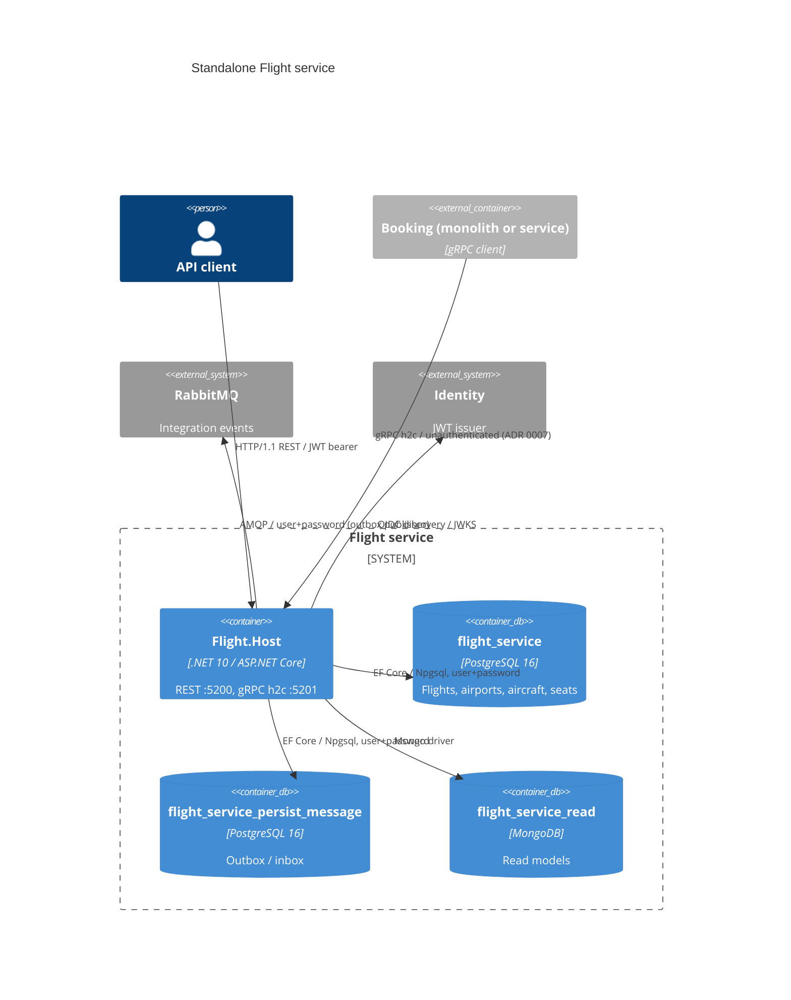

# 0502. Standalone Flight service host

- **Status:** Proposed
- **Date:** 2026-10-13
- **ARB ticket:** TO BE CREATED
- **Authors:** Devin (AB-502)
- **Owning team:** TBD — owner to confirm before ARB
- **Related ADRs:** 0002 (strangler fig), 0003 (inter-service communication), 0004 (database per
  service), 0007 (unauthenticated internal gRPC), 0008 (service host layout and ports), 0492, 0494,
  0501

## Context

Epic AB-488 extracts each module of the modular monolith into its own deployable service while
`src/Api` keeps running unchanged. Flight is extracted first: it owns flights, airports, aircraft
and seats, exposes REST CRUD endpoints and the `FlightGrpcService` that Booking calls
(`GetById`, `GetAvailableSeats`, `ReserveSeat`), and keeps a Mongo read model.

ARB triggers: T1 (new deployable `Flight.Host` with its own Dockerfile), T2 (new service-owned
databases `flight_service`, `flight_service_persist_message` and Mongo `flight_service_read` on the
already-approved PostgreSQL/MongoDB engines; same data, no classification change), T6 (new network
endpoints: REST on 5200/80 behind JWT, internal gRPC h2c on 5201/81, unauthenticated per ADR 0007).
Detector false positives: T3 (`json.schemastore.org` is the `$schema` of `launchSettings.json`, not
a runtime call) and T7 (.NET 10 is the runtime the whole repo already uses).

## Decision

We will add `src/Services/Flight.Host`, a standalone ASP.NET Core host that composes the existing
Flight module (`AddFlightModules` / `UseFlightModules`) with focused BuildingBlocks projects,
`ServiceDefaults` (health, OpenTelemetry, service discovery), JWT for REST, a dedicated
`Protocols: Http2` Kestrel endpoint for gRPC plus gRPC health checks, its own outbox/inbox database
and RabbitMQ publishing through the `MessageBroker` options (AB-501). Migrations and seeding run at
startup against the service-owned databases. Data migration from the monolith DBs is deferred to
cut-over (AB-505); the gateway is repointed separately.

## Alternatives considered

| Alternative | Pros | Cons | Why rejected |
| --- | --- | --- | --- |
| Do nothing | No new deployable | Flight cannot scale/deploy independently | Blocks AB-488 |
| Copy Flight code into a new service project | Fully decoupled from monolith | Two diverging copies during transition | Module stays the single source; host only composes it |
| Share the monolith's Flight databases | No data migration | Shared-DB coupling, two writers, conflicting migrations | Contradicts ADR 0004 |
| gRPC on the same endpoint as REST (`Http1AndHttp2`) | One port | Kestrel cannot serve h2c gRPC on a plain-http mixed endpoint | Separate HTTP/2 port (ADR 0008) |

## Architecture

## Non-functional requirements

| NFR | Target | How met |
| --- | --- | --- |
| Availability SLO | TBD — owner to confirm before ARB | Stateless host, horizontal replicas |
| p95 latency | TBD | Same handlers as monolith; one fewer hop than in-process for reads |
| RPO / RTO | TBD | Postgres backups owned by platform; outbox guarantees event delivery |
| Peak load | TBD | — |
| Scaling model | Horizontal; competing consumers on per-service queues | `MessageBroker:ServiceName` |
| Data retention | Unchanged from monolith | — |

## Security & compliance

- **Data classification:** unchanged — same Flight reference/operational data, no PII.
- **Encryption at rest:** inherited from the Postgres/Mongo deployment (unchanged).
- **Encryption in transit:** plain HTTP/AMQP inside the compose/cluster network as today; TLS
  termination at the gateway. Internal TLS is an epic follow-up.
- **AuthN / AuthZ:** REST endpoints keep `RequireAuthorization(ApiScope)` via JWT from Identity;
  gRPC is unauthenticated service-to-service (accepted risk, ADR 0007).
- **Secrets:** connection strings / broker credentials via environment variables; only local-dev
  defaults committed.
- **Audit logging:** unchanged; outbox/inbox rows in `flight_service_persist_message`.
- **Data residency / regions:** N/A — no cloud resources.
- **Policy sections satisfied:** no infrastructure-as-code changes.
- **Threats considered:** gRPC port must not be exposed outside the internal network.

## Cost

| Item | Assumption | Monthly estimate |
| --- | --- | --- |
| Flight.Host container | One small replica | TBD — owner to confirm |
| Databases | Two new logical DBs on existing Postgres, one on existing Mongo | ~0 incremental |
| **Total** | | TBD (expected well below $2k/mo) |

## Operations

- **On-call rotation:** TBD — owner to confirm before ARB.
- **Runbook:** TBD.
- **Dashboards / alarms:** OpenTelemetry via `ServiceDefaults`; `/health`, `/alive`, gRPC health.
- **Rollback plan:** keep the gateway cluster pointing at the monolith; the service can be stopped
  without affecting `src/Api`.
- **Migration / cut-over plan:** AB-505 (data migration) and gateway repoint.

## Policy exceptions requested

| Rule | Resource | Justification | Compensating control | Expiry |
| --- | --- | --- | --- | --- |
| none | | | | |

## Consequences

- Positive: Flight deploys and scales independently; Booking can call it cross-process.
- Negative / risks: two Flight write paths exist until cut-over; seeded reference data diverges
  from monolith data until AB-505.
- Follow-ups: internal gRPC auth/TLS (ADR 0007), compose/Aspire wiring (sibling tickets).

## Open questions

- Owning team, SLOs, and cost figures above.
