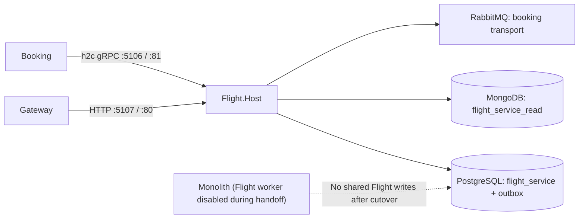

# ADR 0502: Standalone Flight service host

- **Status:** Proposed (ARB_REQUIRED; ARB ticket to be created before merge)
- **Date:** 2026-10-29
- **Ticket:** AB-502
- **Owning team:** Booking platform team
- **Related ADRs:** [0002: per-service data ownership](0002-per-service-data-ownership.md), [0102: RabbitMQ transport and module queues](0102-rabbitmq-transport-and-module-queues.md), [0103: shared gRPC contracts and service addressing](0103-shared-grpc-contracts-and-service-addressing.md)

## Context

Flight currently runs inside the monolith's API process. The Flight module already registers its own database context, named Mongo read context, data seeder, typed outbox, endpoints, and gRPC service. Running it in a separate process requires a host composition root that keeps those registrations inside the module while avoiding Identity, Passenger, Booking, EventStoreDB, and aggregate BuildingBlocks dependencies.

This introduces a new service process and HTTP/2 network listener, with dedicated Flight PostgreSQL and Mongo databases and bearer-token discovery configuration. The change crosses service, data ownership, and network boundaries and therefore requires ARB review before merge. This ADR records the local architecture decision; it does not authorize production cutover.

## Decision

1. Add `src/Services/Flight.Host` as a standalone ASP.NET Core host and reuse `ServiceDefaults`, focused shared BuildingBlocks, the canonical gRPC contracts, and the existing Flight module.
2. Keep module lifecycle and persistence registrations owned by `AddFlightModules()` / `UseFlightModules()`. The host registers only shared host services, JWT, Flight-only MassTransit consumer scanning, gRPC health, and Flight-specific readiness checks.
3. Serve REST, health, and Development OpenAPI on HTTP port 5107 locally / port 80 in Docker. Serve h2c gRPC on the HTTP/2-only port 5106 locally / port 81 in Docker. Keep internal gRPC unauthenticated as in ADR 0103.
4. Give the host its own `flight_service` PostgreSQL database/outbox and `flight_service_read` Mongo read database. Reuse the existing RabbitMQ transport and `booking-modular-monolith` audience. Keep monolith defaults and gateway/Booking defaults unchanged.
5. Map `/health/live` to liveness-only checks and `/health/ready` to all non-live checks in every environment. Expose `grpc.health.v1.Health` for overall service and `flight.FlightGrpcService`, excluding liveness checks.
6. Keep one active Flight background processor per Flight store. Side-by-side routing and worker handoff are configuration-only follow-up work; existing-data migration is deferred to AB-505.

## Architecture

## Consequences

- Flight can start and run independently without composing other business modules or EventStoreDB.
- The host can share the existing Flight module code and canonical gRPC contract while owning a separate process and stores.
- Operators must configure HTTP and gRPC destinations separately and transfer background processing together with traffic ownership.
- A second set of database credentials, backups, connection pools, health checks, and deployment configuration is required.
- Side-by-side operation does not migrate existing Flight data; stale or partial data during cutover must be handled through AB-505.
- Development defaults use plaintext local infrastructure and role-name passwords; production secrets, TLS, and backup policy remain deployment responsibilities.

## Alternatives considered

| Alternative | Decision |
| --- | --- |
| Shared `ServiceHost` library | Rejected. Module hosts have distinct dependencies, routes, listener/configuration needs, and health probes; a common composition library would hide those boundaries and couple unrelated hosts. |
| Keep Flight in the monolith | Rejected for this ticket. It does not establish an independently runnable Flight process for the later route cutover. |
| Duplicate Flight storage/consumer registrations in the host | Rejected. It would split module ownership and risks duplicate migrations, seeding, or outbox processing. |
| Share monolith Flight stores | Rejected. It defeats independent data ownership and leaves lifecycle/credentials coupled; data migration remains a separate AB-505 concern. |

## Operational references

See the [Flight service runbook](../runbooks/flight-service.md), [ADR 0002](0002-per-service-data-ownership.md), [ADR 0102](0102-rabbitmq-transport-and-module-queues.md), and [ADR 0103](0103-shared-grpc-contracts-and-service-addressing.md).

ARB approval, production capacity targets, and production data migration/rollback procedures remain prerequisites to cutover.
