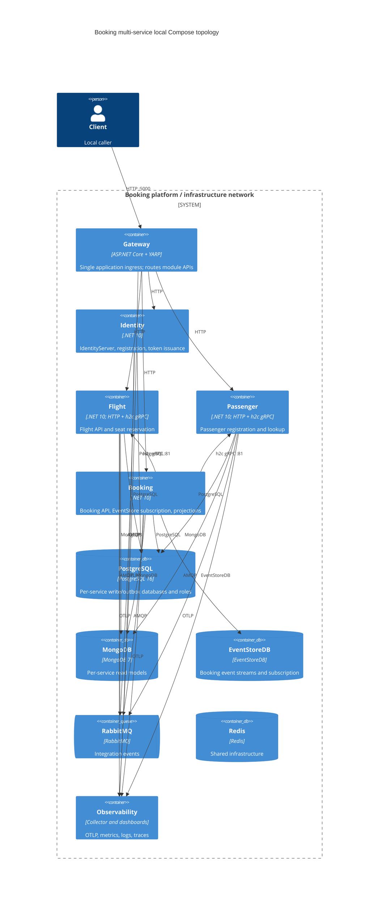

# 0503. Multi-service Docker Compose topology

- **Status:** Proposed
- **Date:** 2026-10-29
- **ARB ticket:** TBD
- **Authors:** Devin (AB-503)
- **Owning team:** Booking platform team
- **Related ADRs:** [0001: YARP API gateway](0001-yarp-api-gateway-single-ingress.md), [0496: Booking service host](0496-standalone-booking-service-host.md), [0502: Flight service host](0502-standalone-flight-service-host.md)

## Context

The repository already contains standalone Identity, Flight, Passenger, and Booking hosts, but the primary Compose file
still launches the modular-monolith API and gateway as a single application topology. Developers and CI need a
repeatable way to run the four service hosts behind the same gateway while retaining the monolith topology for
comparison and transition testing. Each host needs its own Docker image and service-specific data configuration.

## Decision

1. `deployments/docker-compose/docker-compose.yaml` is the services topology. It includes
   `docker-compose.infrastructure.yaml` and declares `identity-service`, `flight-service`, `passenger-service`,
   `booking-service`, and `gateway`. Each app service builds independently from its own Dockerfile.
2. `deployments/docker-compose/docker-compose.monolith.yaml` retains the existing `booking_modular_monolith` and
   `booking_gateway` application services, includes the same infrastructure, and preserves their environment settings.
3. Both application modes use the shared `infrastructure` bridge network. Only the gateway is exposed as a non-loopback
   application port (`5000:80`); diagnostic HTTP and gRPC application ports are bound to `127.0.0.1`.
4. The services topology uses dedicated PostgreSQL databases/roles and Mongo read databases. RabbitMQ uses the
   development-only `booking/booking` credentials; Booking uses EventStoreDB and the Flight/Passenger h2c gRPC
   endpoints. These service addresses are configuration, not a new protocol or external integration.
5. Docker health checks gate startup. Infrastructure health checks cover PostgreSQL, MongoDB, Redis, RabbitMQ, and the
   EventStoreDB image's built-in health check. Readiness checks gate service-to-service startup and gateway ingress.
6. The gateway routes module clusters to service DNS names. Fallback clusters point at Identity with a path rewrite to
   a deliberately unmatched path, making unmatched requests return 404 rather than proxying to a nonexistent
   monolith.
7. A shell smoke flow verifies authentication, identity registration, RabbitMQ-driven Passenger creation,
   registration completion, seeded Flight and seats, Booking creation and its effects, and 404 fallback behavior.
   CI separately builds the five images and starts the compose dependency graph for this flow.
8. Run only one topology at a time. They share project identity, container names, and host ports. Existing PostgreSQL
   volumes are not initialized again; local credentials are not production secrets.

### Container view

## Alternatives

| Alternative | Advantages | Disadvantages | Decision |
|---|---|---|---|
| Keep only the monolith Compose topology | Lowest local complexity; existing end-to-end behavior | Does not exercise independent service images, service discovery, inter-service gRPC, or gateway routing | Rejected; service extraction needs a runnable topology |
| Replace the monolith topology with services only | One default compose file | Removes the simple baseline used for comparison and transition work | Rejected; retain the monolith in its own compose file |
| Duplicate infrastructure in both Compose files | Each file is standalone | Repeats service definitions and risks configuration drift | Rejected; use Compose `include` for shared infrastructure |
| Add Kubernetes/Helm or another orchestrator | Closer to a production cluster | Adds a separate platform and scope beyond local/CI verification | Deferred; Docker Compose meets the ticket's local topology goal |

## Consequences

- Positive: each service image is independently buildable; local and CI runs exercise the service graph, network
  addressing, health gates, gateway routes, and the booking workflow.
- Positive: the monolith topology remains available without duplicating shared infrastructure definitions.
- Negative: users must stop one topology before starting the other; fixed ports and container names prevent side-by-side
  runs.
- Negative: local Compose credentials and HTTP/h2c defaults are intentionally not suitable for production.
- Follow-up: production orchestration, TLS termination, secret delivery, and service-to-service gRPC authentication are
  separate deployment/security decisions.

## Non-functional requirements

| Area | Requirement |
|---|---|
| Availability | Dependency health gates prevent application startup before required stores, brokers, and downstream services are ready. |
| Operability | `docker compose ps` reports health; logs identify failed initialization; the smoke script validates the public booking flow. |
| Buildability | The gateway and four service images each build from repository root with their own Dockerfile. |
| Performance | Local-only topology; no production latency target is introduced. |
| Recovery | Persistent local database volumes are preserved by ordinary `down`; initialization SQL applies only to a fresh PostgreSQL volume. |
| Scale | Run one active instance of each service in this local topology. Booking background processing and EventStoreDB subscription are not intended for multiple replicas. |

## Security

- The gateway is the only non-loopback application ingress. Identity, Flight, Passenger, and Booking diagnostic
  application ports are loopback-bound.
- The infrastructure file publishes database, broker, and observability ports for local developer tools; do not use
  those settings on an untrusted host or production network.
- Compose credentials (`booking/booking` and per-service role-name passwords) are local-development credentials only.
  Production secret management and transport encryption are outside this topology.
- JWT authority and metadata discovery are explicitly configured so public tokens use `http://localhost:5000` while
  containers fetch discovery from `identity-service`.
- Booking-to-Flight and Booking-to-Passenger gRPC is h2c and unauthenticated per the shared service-host decision.
  Production mutual authentication or equivalent service identity remains a follow-up.
- The smoke script passes access tokens through curl config input and does not put bearer tokens on the process command
  line or print them.

## Cost and ownership

- **Infrastructure cost:** no new services, stores, or external vendors. The topology reuses existing local
  PostgreSQL, MongoDB, EventStoreDB, RabbitMQ, Redis, and observability images.
- **Runtime cost:** local container CPU, memory, and disk only; no production cloud estimate applies.
- **Ownership:** Booking platform team owns the Compose files, health gating, smoke script, and runbook. Module owners
  remain responsible for service configuration and health semantics.
- **Maintenance:** update the shared infrastructure once in `docker-compose.infrastructure.yaml`; keep Docker image
  builds and compose workflow aligned with the service Dockerfiles.
