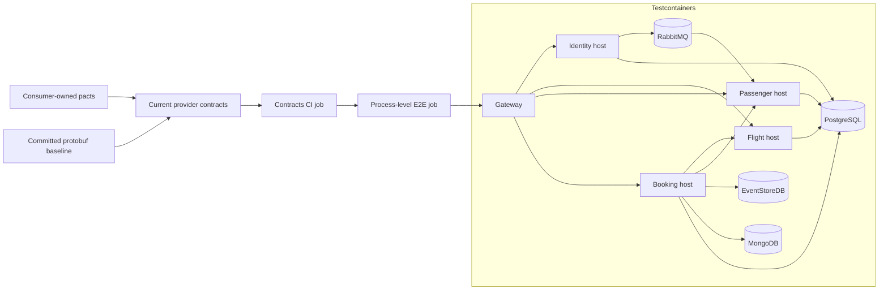

# ADR-0504: Contract and cross-service testing

- Status: Accepted

## Context

Booking's Flight and Passenger gRPC clients and Passenger's Identity event consumer are independently deployed contracts. Existing unit and module integration tests do not prove that those consumers remain compatible with the current provider descriptors and serialized messages. Several host tests also shared the monolith database names, obscuring service ownership, and no automated test exercised the deployed host processes through the Gateway.

## Decision

- Keep consumer-owned message and gRPC pacts in `src/Contracts/pacts/` and verify them against provider message types and descriptors.
- Compare current Flight and Passenger protobuf descriptors with a committed compatibility baseline, reporting breaking wire changes and requiring explicit baseline regeneration for additive changes.
- Use service-owned PostgreSQL databases for Host.Test fixtures while retaining the existing monolith database names for module integration tests.
- Add a Testcontainers process-level E2E suite that launches Identity, Flight, Passenger, Booking, and Gateway as separate processes and uses real PostgreSQL, MongoDB, RabbitMQ, and EventStoreDB transports.
- Run contract verification before the process-level E2E suite in a dedicated CI workflow.

## Alternatives considered

- Rely only on the existing module unit and integration suites: rejected because they do not verify consumer/provider wire compatibility or the Gateway-to-host process boundary.
- Keep using monolith-named databases in service-host tests: rejected because it blurs database ownership and can conceal configuration errors.
- Replace consumer-owned pacts with provider-only snapshots: rejected because provider snapshots do not express which fields and RPCs each consumer actually depends on.

## Consequences

- Contract changes are reviewed explicitly; additive protobuf changes require an intentional baseline update.
- The process-level suite requires Docker and exercises actual transport wiring, increasing test runtime and local resource use.
- Existing monolith integration tests retain their database naming and behavior; Host.Test fixtures use `<module>_service`.
- No production runtime component or protocol is changed by this decision.
