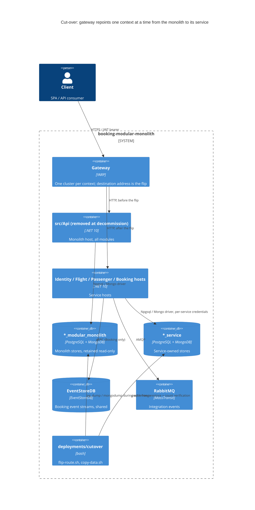

# 0505. Cut-over, rollback and decommission of the monolith host

- **Status:** Proposed
- **Date:** 2026-10-13
- **ARB ticket:** TO BE CREATED
- **Authors:** Devin (AB-505)
- **Owning team:** TBD — owner to confirm before ARB
- **Related ADRs:** 0001 (gateway single ingress), 0002 (strangler fig), 0004 (database per
  service), 0005 (side-by-side background-processing switch), 0492, 0493, 0496, 0498, 0502

## Context

All four service hosts, the YARP gateway (one cluster per context, destination `monolith`), RabbitMQ
and the service-owned databases exist. Traffic still goes to `src/Api`, whose `*_modular_monolith`
databases hold all production data. ADR 0002 deferred the data migration and the decommission of the
host to this ticket and sketched a Flight-first order.

ARB triggers (`/arb-review:arb-triage` verdict **ARB_REQUIRED**):

- **T2 changed data store**: production data moves from the `*_modular_monolith` databases to the
  `*_service` databases, and the monolith databases are later retired.
- **T6 auth / network boundary**: every gateway cluster is repointed to a service, the token issuer
  moves to the Identity service, and signing + Data Protection keys are shared between two hosts.

False positives: the detector's T2 "PII" hit (`docs/runbooks/identity.md`) is a runbook sentence
mentioning the passport field of a smoke-test passenger, not a new store of PII. Not triggered:
T1 (nothing new is deployed; the monolith host is removed), T3 (no new vendor; `pg_dump`/`mongodump`
ship in the postgres/mongo images already in use), T4 (no contract changes), T5 (no
`policy/approved-infra.yaml` in this repo; no new infrastructure), T7, T8, T9.

## Decision

1. **Order Identity -> Flight -> Passenger -> Booking**, one context per window with burn-in.
   Identity first because every other context validates its tokens: moving it while nothing else has
   moved isolates token-continuity problems. Booking last because it calls Flight and Passenger over
   gRPC. (Supersedes the Flight-first sketch of ADR 0002.)
2. **A flip is an atomic hand-over of route + data + background ownership** (`deployments/cutover/
   flip-route.sh`): freeze the context's gateway route, drain the owner's outbox, switch off its
   `Modules:<M>:BackgroundProcessingEnabled`, copy Postgres + Mongo data with row/document-count
   verification, switch on the new owner, repoint
   `ReverseProxy__Clusters__<m>__Destinations__monolith__Address`, verify the upstream from the
   gateway's proxy log. A short per-context write outage (502 for that context, ~1-2 min) is accepted
   in exchange for no dual writes and no split-brain read models.
3. **Rollback is the same procedure in reverse**, including copying the service's data back, so it is
   lossless at any point before decommission (validated for Flight on compose).
4. **Booking's EventStoreDB is shared, not migrated**: both hosts use the same streams and the same
   checkpoint stream; only the Mongo read model moves.
5. **Identity signing material is shared** between the two Identity hosts (developer key + Data
   Protection key ring for Duende's automatic keys) so tokens survive an Identity flip either way.
6. **Canary only reads, or only while stores are shared** (header route or extra destination);
   default is dark launch with background processing off.
7. **Decommission** removes `src/Api` (project, Dockerfile, monolith compose, CI image, Aspire
   resource); module test projects run against the service hosts; gateway defaults point every
   cluster at its service. Monolith databases are kept read-only for a retention period, then dropped.

## Alternatives considered

- **Online dual-write / CDC sync instead of a freeze**: zero downtime but needs a replication pipeline
  and conflict handling for both directions; disproportionate for current data volumes. Documented as
  the scale-up path (logical replication pre-seed, copy becomes verify-only).
- **Services keep using the monolith databases (shared DB) after cut-over**: makes flips config-only
  but violates ADR 0004 and leaves decommission blocked on a later, riskier data split.
- **Weighted canary with writes on both sides**: splits data between two owners; rejected.

## Architecture

Transition and end state (see also `docs/architecture/cutover-sequence.mmd`,
`docs/architecture/transition-state.mmd`):

## Non-functional requirements

| NFR | Target | How met |
| --- | --- | --- |
| Availability SLO | TBD — owner to confirm before ARB | Per-context write outage only during a flip window |
| p95 latency | No regression > 2x baseline for 15 min | Runbook rollback trigger |
| RPO / RTO | RPO 0 (writes frozen during copy); flip/rollback RTO ~1-2 min per context on compose | Freeze + drain + count-verified copy; rollback is the reverse copy |
| Peak load | TBD — owner to confirm before ARB | Flips are scheduled for low-traffic windows |
| Scaling model | Unchanged (service hosts scale independently; Booking exactly one background owner) | ADR 0005 switch |
| Data retention | Monolith DBs read-only after decommission for a retention period (TBD), then dropped | `docs/runbooks/decommission.md` |

## Security & compliance

- **Data classification:** unchanged — the same passenger/user/booking data moves between stores of the
  same environment; no new data fields.
- **Encryption at rest:** unchanged; inherits the platform's PostgreSQL/Mongo configuration.
- **Encryption in transit:** dumps are streamed through a pipe (no files at rest); production must run
  the copy inside the platform network with TLS-enabled connection strings.
- **AuthN / AuthZ:** the Identity service becomes the issuer; signing material is shared during the
  transition so existing tokens stay valid in both directions; gateway keeps JWT validation.
- **Secrets:** scripts take credentials from the environment (`PG*`, Mongo URI) — no secrets committed;
  compose values are local-only defaults. Signing keys live on a shared volume, not in git.
- **Audit logging:** each flip step is logged with a timestamp and the persisted route state.
- **Data residency / regions:** unchanged.
- **Policy sections satisfied:** no `policy/approved-infra.yaml` in this repo; no new infrastructure.
- **Threats considered:** split-brain writes (prevented by freeze + single background owner), stale
  outbox replay (target outbox truncated), token rejection after a flip (shared key ring).

## Cost

| Item | Assumption | Monthly estimate |
| --- | --- | --- |
| Side-by-side hosting during cut-over | Monolith + service hosts both running for the migration weeks | TBD — owner to confirm |
| After decommission | Monolith host and its CI image removed | Net reduction |
| **Total** | No new recurring infrastructure | < $500/mo expected; TBD |

## Operations

- **On-call rotation:** TBD — owner to confirm before ARB.
- **Runbook:** `docs/runbooks/README.md` plus one file per context and `decommission.md`.
- **Dashboards / alarms:** per-context 5xx, p95, readiness, outbox depth, RabbitMQ error queues,
  Booking projection lag (thresholds in the runbook).
- **Rollback plan:** `flip-route.sh <context> monolith` before decommission (validated for Flight);
  previous service image afterwards.
- **Migration / cut-over plan:** Identity -> Flight -> Passenger -> Booking, then decommission.

## Policy exceptions requested

| Rule | Resource | Justification | Compensating control | Expiry |
| --- | --- | --- | --- | --- |
| none | | | | |

## Consequences

- Per-flip write outage for one context; runbook defines monitoring thresholds and rollback triggers.
- After decommission there is no monolith fallback; rollback means redeploying previous service images.
- Production execution needs secrets-managed DB credentials and the same steps in the deployment
  platform (env vars on gateway/host deployments); the compose scripts are the reference implementation.

## Open questions

- Owning team, availability SLO, peak load, retention period and cost figures (marked TBD).
- Whether production data volume needs the logical-replication pre-seed instead of a copy under freeze.
