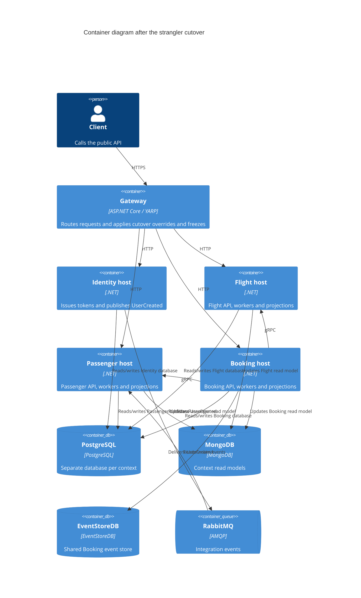

# ADR 0505: Strangler cutover and monolith decommission

- Status: Proposed
- Date: 2026-10-29
- Architecture review ticket: TO BE CREATED

## Context

The Identity, Flight, Passenger, and Booking service hosts are independently runnable,
but the legacy `src/Api` host still owns routes and data during migration. A cutover must
transfer one module at a time without running duplicate background processors, while
preserving a tested path back to the legacy owner. Identity signing and Data Protection
keys must remain stable across host changes so existing tokens and protected data remain
valid.

## Decision

- Keep the gateway as the single ingress. It loads optional, reloadable cutover overrides
  from a mounted JSON file and can freeze selected clusters with a 503 response.
- Use a Compose overlay for the legacy host and shared Identity key volumes. The legacy
  image is built before `src/Api` is removed and remains available for rollback drills.
- Store owners, worker switches, and flip progress in a local cutover state file. During a
  flip, freeze the required routes, stop competing workers, copy and verify data, then
  move the gateway route and unfreeze it.
- Verify reverse synchronization with a Flight write made while the service owns the
  route, and verify Identity continuity with a token minted before its route changes.
- After the required live drills, remove `src/Api`, its solution and Aspire references,
  and monolith-only tests and deployment defaults. Keep rollback tooling capable of
  starting the separately built legacy image.

## Consequences

- Only one host may run a module's background processing at a time.
- Rollback depends on the legacy image and the shared Identity key volumes being retained.
- PostgreSQL copies are checked by public-table counts. Flight and Passenger Mongo read
  models are copied and count-checked; Booking's Mongo read model is rebuilt from the
  shared EventStoreDB.
- The local state file and overrides are operational artifacts and must not be committed.
- A failed or interrupted flip can leave a route frozen; operators must inspect the
  recorded stage and resume or safely abort before starting another flip.

## Architecture

## Non-functional requirements

- **Availability:** A context is unavailable for approximately its freeze window while
  ownership changes; the other contexts continue serving traffic.
- **Recovery point objective:** RPO is 0 within the freeze because writes are blocked
  until the copy and verification complete.
- **Recovery time objective:** RTO is approximately the duration of the owner flip,
  including copy, validation, health checks, and route reload.
- **Data classification:** Identity and Passenger contain PII; treat their copies,
  logs, backups, and retained source databases accordingly.

## Security and compliance

- Production data copies remain inside the PostgreSQL container/environment boundary;
  the process does not expose a new copy endpoint.
- Gateway route freeze is existing middleware/configuration and adds no public endpoint.
- Identity signing and Data Protection volumes contain key material and must be protected
  and backed up with restricted access.
- The shared identity-signing volume is the only source of signing keys; the legacy image
  contains no signing keys.
- Development credentials in Compose and scripts are local-only and must not be reused in
  production.

## Cost

No new production infrastructure or external service is introduced. The additional
recurring cost is storage for the retained legacy image in the private registry.

## Operations

- **Owner:** Service platform/on-call team coordinates the flip; each bounded-context
  owner validates its data and service behavior.
- **Runbook:** `docs/runbooks/cutover.md`.
- **CI drill:** `.github/workflows/cutover.yml` builds the legacy image and service images,
  exercises rollback and token continuity, cuts over all contexts, decommissions the
  monolith, and runs the Compose smoke test.

## Alternatives considered

- Keep the monolith as the permanent fallback for all routes: rejected because it leaves
  a hidden runtime dependency after module ownership has moved.
- Switch routes without worker quiescence or data verification: rejected because writes
  and outbox processing could diverge between owners.
- Rebuild the Booking read model by copying Mongo data: rejected because the shared
  EventStoreDB is the source of truth for that projection.
