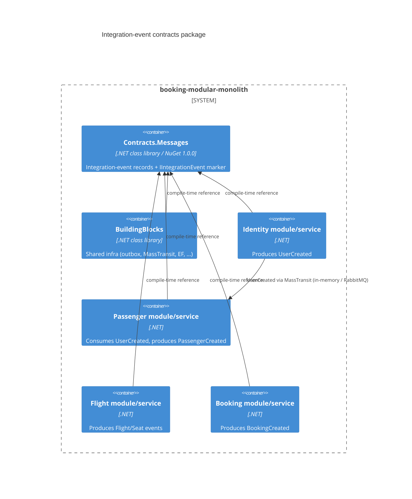

# 0506. Extract integration-event contracts into a versioned package (AB-506)

- **Status:** Proposed
- **Date:** 2026-10-13
- **ARB ticket:** TO BE CREATED (no ARB Jira project exists on the cog-gtm site)
- **Authors:** Devin (for Abhay Aggarwal)
- **Owning team:** Booking platform (all four module teams consume it)
- **Related ADRs:** none yet; part of epic AB-488 (microservices migration scaffolding)

## Context

All integration-event contracts (`UserCreated`, `FlightCreated`, `PassengerCreated`,
`BookingCreated`, ...) lived inside the BuildingBlocks mega-assembly at
`src/BuildingBlocks/Contracts/EventBus.Messages`. Once the modules are split into separately
deployed services (epic AB-488) each service must be able to pin the contract version it was built
against without pulling in all of BuildingBlocks (EF Core, IdentityServer, Testcontainers, ...).

ARB triggers: **T8** — a new shared library consumed by every module/service team. T4 was reviewed
and is *not* hit: no message is added, removed, renamed or reshaped, and the namespace (which
drives MassTransit URNs and the outbox `DataType`) is unchanged, so the wire contract is identical.
The heuristic detector reported none (NO_ARB); T8 was added on manual review.

## Decision

We will move the contracts into a standalone class library `src/Contracts/Contracts.Messages`
(assembly `Contracts.Messages`, NuGet id `BookingModularMonolith.Contracts.Messages`, SemVer,
starting at `1.0.0`) that depends only on `MassTransit.Abstractions` and `MediatR.Contracts`.
The minimal `IEvent` / `IIntegrationEvent` marker interfaces move with it (same
`BuildingBlocks.Core.Event` namespace) and BuildingBlocks references the package project.
Compatibility is governed by `docs/contracts/compatibility-policy.md`: additive changes only,
breaking changes ship as a new `V`-suffixed type.

## Alternatives considered

| Alternative | Pros | Cons | Why rejected |
| --- | --- | --- | --- |
| Do nothing | No churn | Every split service must reference all of BuildingBlocks; no independent versioning | Blocks the service split |
| Per-producer contract packages (Identity.Contracts, Flight.Contracts, ...) | Finer-grained ownership | 4 packages to version for 11 tiny records; consumers need several | Premature; can be split later additively |
| Move contracts and rename namespace to `Contracts.Messages` | Cleaner naming | Changes MassTransit message URNs/exchange names and outbox type resolution — a breaking wire change between monolith and services | Violates the compatibility policy this ADR introduces |
| Schema-first (protobuf/Avro + registry) for async events | Language-neutral, registry-enforced compatibility | New infra + tooling; all consumers are .NET today | Over-engineered for current scope |

## Architecture

## Non-functional requirements

| NFR | Target | How met |
| --- | --- | --- |
| Availability SLO | N/A — compile-time library, no runtime component | |
| p95 latency | N/A — no runtime change | |
| RPO / RTO | N/A | |
| Peak load | N/A | |
| Scaling model | N/A | |
| Data retention | N/A | |

## Security & compliance

- **Data classification:** unchanged. `UserCreated` already carries name + passport number (PII); this change moves the type, it does not add fields or new flows.
- **Encryption at rest:** N/A — no new storage.
- **Encryption in transit:** unchanged (broker transport config is owned by the MassTransit/RabbitMQ tickets).
- **AuthN / AuthZ:** N/A.
- **Secrets:** none.
- **Audit logging:** N/A.
- **Data residency / regions:** N/A.
- **Policy sections satisfied:** no infrastructure; `policy/approved-infra.yaml` not applicable.
- **Threats considered:** supply chain — package is built from this repo only and published to a local feed (`artifacts/packages`); dependencies are the already-used MassTransit 8.5.8 / MediatR.Contracts 2.0.1.

## Cost

| Item | Assumption | Monthly estimate |
| --- | --- | --- |
| None | Local NuGet feed on disk / CI artifacts | $0 |
| **Total** | | $0 |

## Operations

- **On-call rotation:** N/A — no runtime component.
- **Runbook:** `docs/contracts/compatibility-policy.md` (how to evolve and pack contracts).
- **Dashboards / alarms:** N/A.
- **Rollback plan:** revert the PR; types and namespaces are unchanged so no data/queue migration is needed.
- **Migration / cut-over plan:** in-repo consumers use `ProjectReference`; split services can switch to `PackageReference` against the local feed once AB-500's `nuget.config` lands.

## Policy exceptions requested

| Rule | Resource | Justification | Compensating control | Expiry |
| --- | --- | --- | --- | --- |
| none | | | | |

## Consequences

- Positive: services depend on a small, versioned contract artifact instead of BuildingBlocks; explicit compatibility rules.
- Negative / risks: `IEvent` (base of domain events too) now lives in the contracts assembly; the `BuildingBlocks.*` namespace on contract types is historical and slightly misleading (kept deliberately for wire compatibility).
- Follow-ups: automated contract/compatibility tests (schema snapshot) in CI; publish to a shared feed once one exists.

## Open questions

- Should contract ownership be split per producing service once teams are separate?
