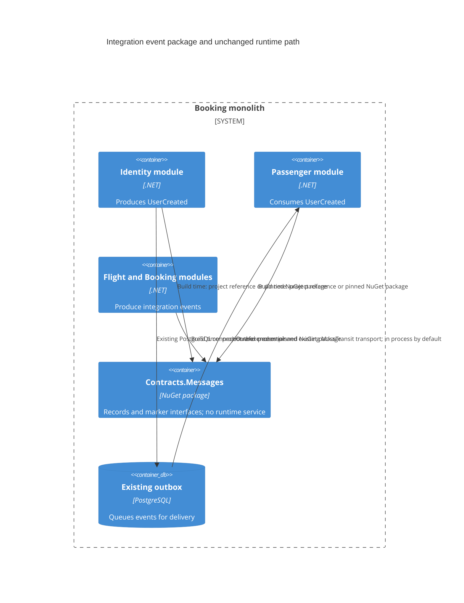

# 0506. Extract versioned integration-event contracts

- **Status:** Proposed
- **Date:** 2026-11-19
- **ARB ticket:** [AB-622](https://cog-gtm.atlassian.net/browse/AB-622)
- **Owners:** Booking migration maintainers; Identity owns `UserCreated`, Passenger owns its consumer.
- **Related:** [ADR 0100](0100-buildingblocks-shared-libraries.md), [migration ADR set (AB-611)](https://cog-gtm.atlassian.net/browse/AB-611)

## Context

Each future service needs to choose when to upgrade the event schemas it produces or consumes. In the split
BuildingBlocks, integration messages still ship with the platform version. Moving the types must not change
MassTransit message URNs or prevent the monolith from processing existing outbox rows.

ARB triggers: T4 (independently versioned cross-service event contract), T8 (shared package).

## Decision

We will ship the existing eleven records and their event interfaces as `BookingModularMonolith.Contracts.Messages`
1.0.0, independent of BuildingBlocks. In-repo builds use a project reference; independent builds can pin an exact
package version. The existing CLR names, payloads and topology stay unchanged; Core and the legacy Contracts
assembly forward their moved types. CI compares the public message shape and URNs against a checked-in baseline
and exercises the packaged `UserCreated` contract. Add optional members in a minor release; give breaking changes
a new message type and keep the old version until consumers have migrated.

## Alternatives considered

| Alternative | Benefit | Why rejected |
| --- | --- | --- |
| Do nothing | No build graph changes | Services cannot choose event versions independently of BuildingBlocks. |
| One package per producing module | Independent ownership and releases | Four packaging lifecycles for eleven records; revisit when service repositories are split. |
| Rename the CLR namespace for the new package | Matches the new package name | Changes URNs and persisted outbox type names, requiring a runtime migration. |

## Architecture

## Non-functional requirements

| NFR | Target and verification |
| --- | --- |
| Availability, RPO/RTO and retention | Unchanged: no new service, persistence, or retention policy. |
| p95 latency, peak load and scaling | Unchanged: same payloads, routing and workers. No new performance target. |
| Backward compatibility | Baseline checks, legacy type resolution and an in-memory publish/consume check on the packed package. |

## Security & compliance

- **Data classification:** Unchanged. `UserCreated` already contains name and passport number (PII); no new fields, destinations or retention.
- **Encryption at rest and in transit, auth, secrets, audit and residency:** Unchanged; applies to the existing transport and stores. The package holds code, not event instances.
- **Policies and threats:** No new infrastructure or policy exception. CI uses a local folder feed; external publishing is not introduced. Exact version pins and the schema baseline guard against unintended drift.

## Cost

No incremental hosting, network, or storage service (\$0/month); packaging and compatibility checks use the existing CI runners.

## Operations

- **On-call:** Unchanged; existing module ownership and alerts apply. No new dashboard or alarm.
- **Runbook:** [Packing, on-disk feed and compatibility procedure](../../src/Contracts/README.md).
- **Rollout and rollback:** Deploy the same monolith through the existing pipeline; there is no routing or data migration. Roll back the monolith image if needed; an independently built consumer can restore its previous package pin.

## Policy exceptions requested

None.

## Consequences

Services can move at different speeds while sharing the same wire schema. The team must review baseline changes
and maintain parallel message versions when a change is breaking.

## Open questions

Shared release ownership and registry publishing for independently deployed services belong to a later slice.
