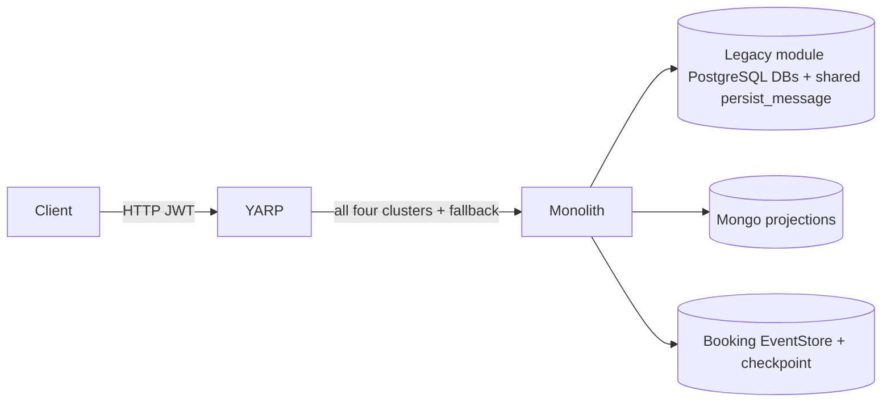
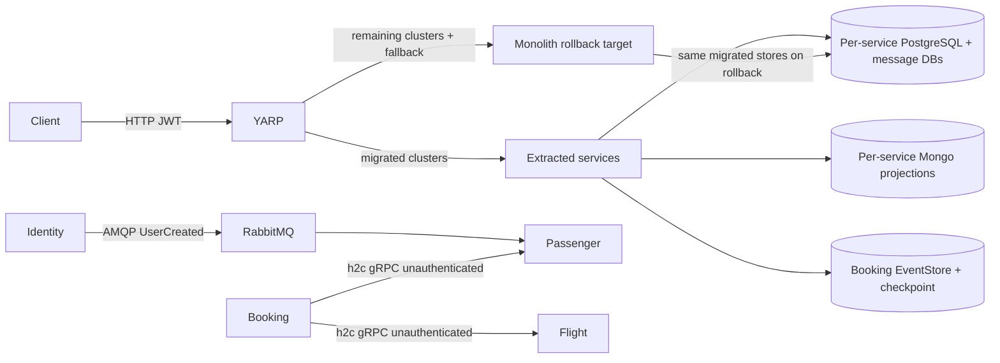
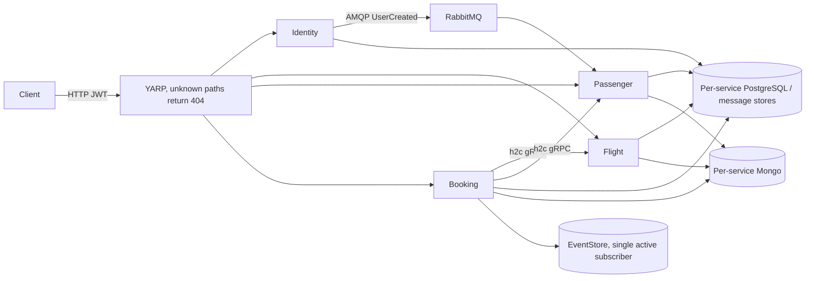

# Cutover architecture — before, during, after

Operational entry point: [cutover runbooks](../runbooks/cutover/README.md).
Existing target: [target architecture](target-architecture.md). Arrows show HTTP routing, not
background ownership. All production data transitions require a write pause and reconciliation.

## Before (legacy production, not the default local Compose configuration)

## During (Flight first, then Identity + Passenger, then Booking)

Only one Booking subscriber. Legacy consumer registration must be isolated for production
coexistence; module background flags alone do not isolate MassTransit consumers.

## After (current repository topology)

No new infrastructure/vendor is introduced. Local HTTP/h2c is not production transport security.
The monolith host and fallback are retired. Recovery explicitly redeploys a previous-release
image using the rollback overlay; it is not part of normal startup.
