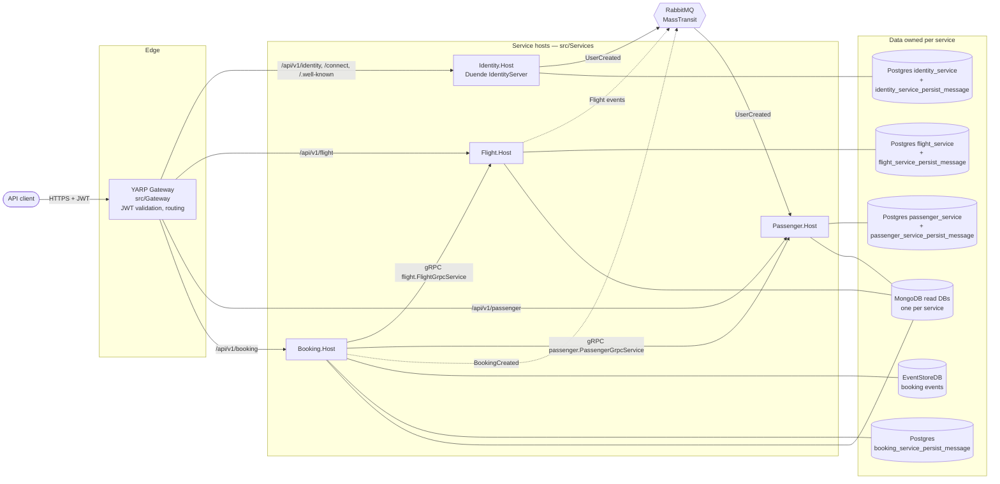
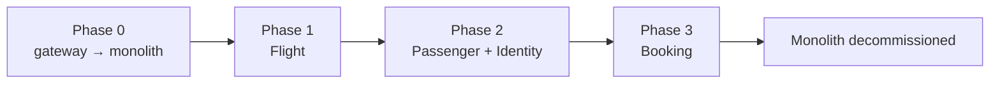

# Target architecture

For migration stages and rollback boundaries see [cutover architecture](cutover.md).

Current service-only topology of epic **AB-488**: the modular monolith is split into four services, one per
module, behind a YARP gateway, using the strangler-fig approach. The decisions behind each part
are recorded in [docs/adr](../adr/README.md).

Mermaid source: [assets/target-architecture.mmd](../../assets/target-architecture.mmd)
(render with `npx -p @mermaid-js/mermaid-cli mmdc -i assets/target-architecture.mmd -o assets/target-architecture.png`).
The same diagram, rendered by GitHub:

## Services and what they own

| Service | Host | Owns | Write store | Read store | Exposes | Depends on |
| --- | --- | --- | --- | --- | --- | --- |
| Identity | `src/Services/Identity.Host` | users, roles, token issuing | Postgres `identity_service` | — | `/api/v1/identity/*`, `/connect/*`, `/.well-known/*`; publishes `UserCreated` | — |
| Flight | `src/Services/Flight.Host` | aircraft, airports, flights, seats | Postgres `flight_service` | Mongo `flight_service_read` | `/api/v1/flight/*`; gRPC `flight.FlightGrpcService` | — |
| Passenger | `src/Services/Passenger.Host` | passenger profiles | Postgres `passenger_service` | Mongo `passenger_service_read` | `/api/v1/passenger/*`; gRPC `passenger.PassengerGrpcService` | `UserCreated` (RabbitMQ) |
| Booking | `src/Services/Booking.Host` | bookings (event sourced) | EventStoreDB | Mongo `booking_service_read` | `/api/v1/booking/*` | Flight + Passenger gRPC |

Every service has its own outbox and inbox store and its own database role; no service touches
another service's stores ([ADR 0004](../adr/0004-database-per-service-and-per-service-outbox-inbox.md)).

## Communication

| From | To | Style | Contract | Config |
| --- | --- | --- | --- | --- |
| Client | Gateway | HTTPS + JWT (audience `booking-modular-monolith`) | REST, `/api/v1/...` | — |
| Gateway | Services | HTTP, `Authorization` forwarded | REST | YARP clusters per module |
| Booking | Flight | gRPC (internal, unauthenticated for now — [ADR 0008](../adr/0008-defer-service-to-service-grpc-authentication.md)) | `src/Contracts/Contracts.Grpc/flight.proto` | `Grpc:FlightAddress` |
| Booking | Passenger | gRPC (same) | `src/Contracts/Contracts.Grpc/passenger.proto` | `Grpc:PassengerAddress` |
| Identity | Passenger | RabbitMQ via MassTransit, outbox → inbox (dedupe on `MessageId`) | `UserCreated` in `src/Contracts/Contracts.Messages` | `RabbitMqOptions` |

Contracts change only additively; breaking changes go through a new version
([ADR 0005](../adr/0005-contract-and-proto-versioning-policy.md)).

## Migration path

See [ADR 0002](../adr/0002-strangler-fig-migration-behind-yarp-gateway.md) and
[ADR 0007](../adr/0007-extraction-order.md).

## Cross-cutting

- Health: `/health/live` and `/health/ready` on every host (gateway included).
- Tracing and metrics: OpenTelemetry with one `service.name` per host.
- Local orchestration: Aspire (`src/Aspire`) and Docker Compose (`deployments/docker-compose/`);
  Kubernetes via Helm (`deployments/k8s/`).
