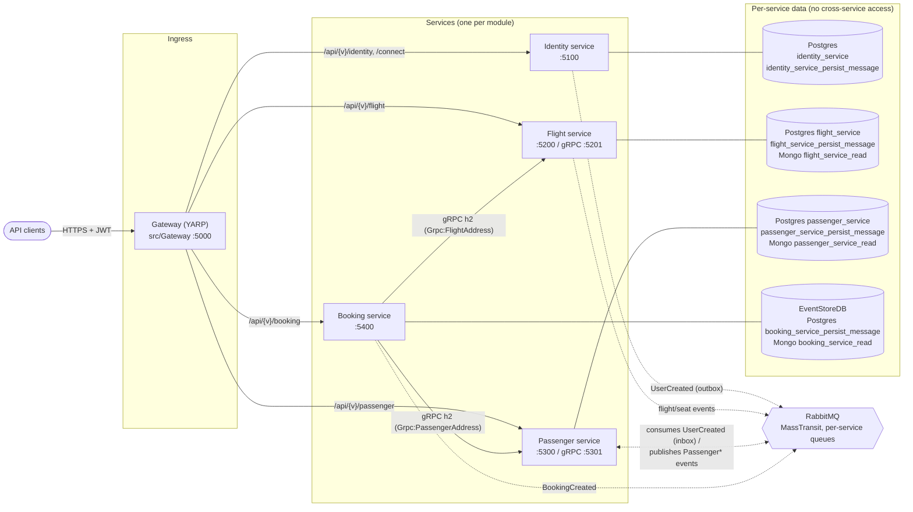
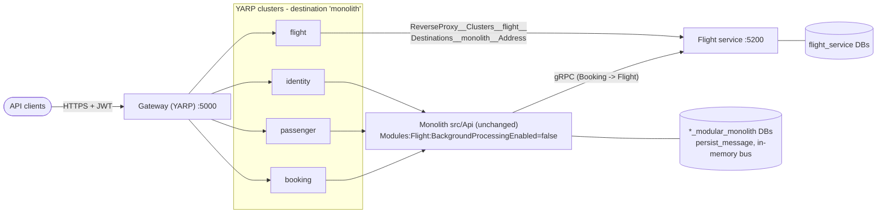

# Target microservices architecture

Target state for epic [AB-488](https://cog-gtm.atlassian.net/browse/AB-488) - migrating the booking
modular monolith to one service per module. Decisions are recorded in the
[ADRs](../adr/README.md); this page is the visual summary.

- Rendered SVGs: [target state](../../assets/microservices-target-architecture.svg),
  [transition state](../../assets/microservices-transition-state.svg)
- Mermaid sources: [target-state.mmd](target-state.mmd), [transition-state.mmd](transition-state.mmd)
  (re-render with `npx @mermaid-js/mermaid-cli -i <file>.mmd -o ../../assets/<file>.svg -b white`)

## Current state

One host (`src/Api`) composes Identity, Flight, Passenger and Booking. Modules talk via in-process
gRPC (Booking -> Flight/Passenger) and MassTransit's in-memory bus; per-module Postgres databases
(`*_modular_monolith`), a shared outbox DB (`persist_message`), one Mongo read DB
(`booking_modular_monolith_read`) and EventStoreDB. See
[assets/booking-modular-monolith.png](../../assets/booking-modular-monolith.png).

## Target state

| Concern | Decision | ADR |
| --- | --- | --- |
| Service boundaries | Identity, Flight, Passenger, Booking - one service per existing module | [0001](../adr/0001-service-boundaries.md) |
| Ingress / migration | YARP gateway (`src/Gateway`, :5000), strangler-fig, one cluster per module with destination `monolith` | [0002](../adr/0002-strangler-fig-migration-behind-gateway.md) |
| Sync comms | gRPC Booking -> Flight/Passenger, `Grpc:FlightAddress` / `Grpc:PassengerAddress`, dedicated h2 ports | [0003](../adr/0003-inter-service-communication.md) |
| Async comms | RabbitMQ via MassTransit, `MessageBroker` options (`TransportType` InMemory\|RabbitMq), per-service queues | [0003](../adr/0003-inter-service-communication.md) |
| Data ownership | Database per service + per-service outbox/inbox; no cross-service DB access | [0004](../adr/0004-data-ownership-database-per-service.md) |
| Side-by-side | `Modules:<Module>:BackgroundProcessingEnabled` (default `true`) in the monolith | [0005](../adr/0005-side-by-side-background-processing-switch.md) |
| Contracts | `src/Contracts/Contracts.Messages` + `Contracts.Grpc`, SemVer, additive-only, breaking = new version | [0006](../adr/0006-contract-and-proto-versioning.md) |
| Internal auth | Service-to-service gRPC unauthenticated for now (accepted risk, ARB follow-up) | [0007](../adr/0007-unauthenticated-internal-grpc-accepted-risk.md) |
| Layout / ports | `src/Services/<Module>.Host`, ports 5100/5200(+5201)/5300(+5301)/5400 | [0008](../adr/0008-service-host-layout-and-ports.md) |

### Ports and data stores

| Service | HTTP | gRPC (h2) | Container | Postgres | Outbox/inbox DB | Mongo read DB | Other |
| --- | --- | --- | --- | --- | --- | --- | --- |
| Gateway | 5000 | - | 80 | - | - | - | - |
| Identity | 5100 | - | 80 | `identity_service` | `identity_service_persist_message` | - | - |
| Flight | 5200 | 5201 | 80 / 81 | `flight_service` | `flight_service_persist_message` | `flight_service_read` | - |
| Passenger | 5300 | 5301 | 80 / 81 | `passenger_service` | `passenger_service_persist_message` | `passenger_service_read` | - |
| Booking | 5400 | - | 80 | - | `booking_service_persist_message` | `booking_service_read` | EventStoreDB |

## Transition state (strangler-fig)

Example: Flight has been peeled off. The gateway's `flight` cluster now points at the Flight
service; every other cluster still points at the unchanged monolith, which has Flight's
background processing switched off. Rollback = set the address back and re-enable the switch -
config-only until the Flight service DB has accepted writes, after that it needs the AB-505 data-sync
step ([ADR 0002](../adr/0002-strangler-fig-migration-behind-gateway.md)). Flight goes first because no
other module consumes its events; Identity and Passenger share `UserCreated`, so they flip together
or with the monolith on RabbitMQ.

## Migration phases

| Phase | Work | Tickets |
| --- | --- | --- |
| 0 - Foundation | Target architecture + ADRs (this page) | AB-499 |
| 1 - Platform | Gateway; BuildingBlocks split + local NuGet feed; shared event contracts; shared gRPC protos; RabbitMQ transport; per-service DBs/outbox/inbox | AB-489, AB-500, AB-506, AB-494, AB-501, AB-492 |
| 2 - Service hosts | Identity, Flight, Passenger, Booking hosts | AB-493, AB-502, AB-498, AB-496 |
| 3 - Run & ship | Aspire multi-service AppHost; Dockerfiles + multi-service compose; observability/health/tracing; per-service CI/CD; Kubernetes/Helm | AB-497, AB-503, AB-495, AB-490, AB-491 |
| 4 - Verify | Cross-service E2E + contract tests | AB-504 |
| 5 - Cutover | Data migration, route flips, rollback runbook, decommission `src/Api` | AB-505 |
