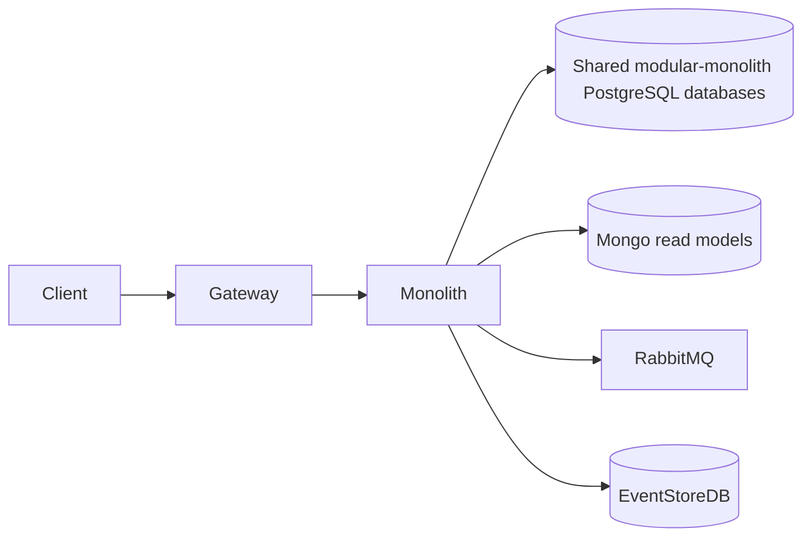
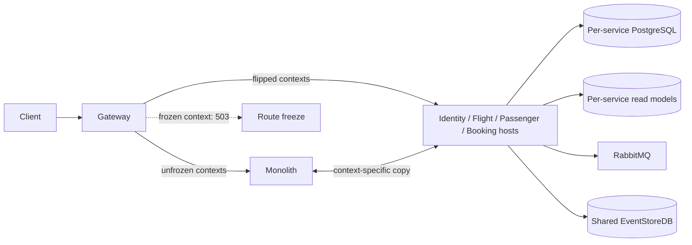
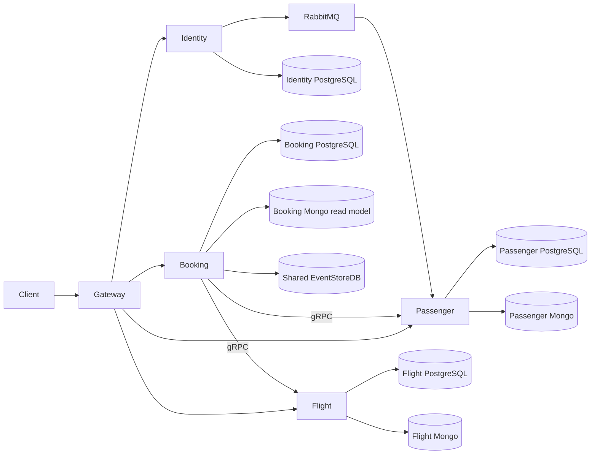

# Strangler cutover and rollback

This runbook moves module ownership between the legacy monolith and its service host. The
cutover overlay is for local drills; it is not a production deployment manifest. Keep the
stack running when collecting evidence.

## Prerequisites

- Docker Engine and Compose, `jq`, and `curl`.
- The service topology and its infrastructure are defined in `docker-compose.yaml`.
- Build the legacy image before removing `src/Api`:

  ```bash
  scripts/cutover/build-legacy-monolith.sh
  ```

- If host port 8080 is occupied, set `CADVISOR_HOST_PORT` to an unused port, for example
  `18080`.

## Start and inspect the drill stack

```bash
CADVISOR_HOST_PORT=18080 scripts/cutover/cutover.sh up
scripts/cutover/cutover.sh status
```

The gateway is the public ingress at `http://localhost:5000`. The monolith diagnostic
endpoint is loopback-only at `http://127.0.0.1:3001`. Its image is selected by
`MONOLITH_IMAGE` (default `booking-modular-monolith:legacy`).

The script creates `deployments/docker-compose/.cutover/state.env` and generates
`deployments/docker-compose/.cutover/gateway/overrides.json`. Do not edit either file
while a flip is in progress. The state file tracks each module's owner and background
worker switches; only the active owner runs background processing.

## Validate rollback and Identity continuity

Run the Flight rollback drill while `flight-service` owns the route. It writes through the
gateway, copies service data back to the legacy database, and proves the monolith can read
the write after the route returns:

```bash
scripts/cutover/validate-rollback.sh flight
```

Mint a token before moving Identity, then verify it remains accepted after the Identity
route changes:

```bash
scripts/cutover/validate-token-continuity.sh
```

Identity signing keys and Data Protection keys are mounted from shared named volumes in
the service topology and cutover overlay. The drill should be considered incomplete
unless both hosts use those mounts and tokens minted before a flip validate afterward.

## Move ownership

Move one context to a service or back to the monolith:

```bash
scripts/cutover/cutover.sh flip flight service
scripts/cutover/cutover.sh flip flight monolith
```

The script freezes the context-specific route set, quiesces the old worker, stops the
target host, copies and verifies data, starts the new owner, then unfreezes and probes
the route. Freeze sets are Flight `{flight, booking}`, Passenger `{passenger, booking}`,
Booking `{booking}`, and Identity `{identity}`. If a flip fails, leave the affected route
frozen and inspect the state and Compose logs before continuing.

To move all modules to service hosts and retire the monolith:

```bash
scripts/cutover/cutover.sh all
scripts/cutover/cutover.sh decommission
scripts/smoke/compose-e2e.sh
```

PostgreSQL table counts are checked after restore. Flight and Passenger Mongo read models
are copied and checked by collection counts; Booking's read model is rebuilt from the
shared EventStoreDB rather than copied. Identity copies PostgreSQL data only.
Flight synchronization reconciles Mongo seat IDs to the copied PostgreSQL seat IDs by
flight and seat number. Existing local stores can contain mismatched projection IDs,
which otherwise prevents a successful seat reservation from updating its read model.

## Roll back

Flip each module back explicitly; the reverse copy happens before the gateway route moves:

```bash
scripts/cutover/cutover.sh flip flight monolith
scripts/cutover/cutover.sh flip passenger monolith
scripts/cutover/cutover.sh flip booking monolith
scripts/cutover/cutover.sh flip identity monolith
```

An interrupted flip records its stage in the state file. Resume the same flip command.
Aborting restores routing to the currently authoritative owner without copying data.
Keep the legacy image available after decommission so rollback remains possible.

## Recommended order and dependencies

Move contexts in this order: Flight, Passenger, Booking, then Identity. Flight is a leaf
with no inbound asynchronous dependency; Booking calls it over gRPC. Passenger follows,
so its RabbitMQ consumer is ready before Identity starts producing `UserCreated` events
from its standalone host. Booking moves after both gRPC dependencies are service-owned.
Identity moves last because it issues tokens and publishes the asynchronous event that
creates Passenger records.

`cutover.sh all` uses the same order (`flight passenger booking identity`). It does not
perform one atomic switch: each context is frozen, copied, verified, routed, and unfrozen
separately. Treat a failure as a partially completed sequence and inspect the state file
before retrying.

## Per-context cutover checklist

Each flip freezes the route set shown below, disables processing on the former owner,
copies the context's data, starts the new owner, verifies it, then unfreezes traffic.
Issue the listed rollback command if the new owner cannot be validated.

### Flight

- **Freeze:** Flight and Booking routes (`{flight, booking}`).
- **Data:** PostgreSQL `flight_modular_monolith` ↔ `flight_service`; copy Mongo
  `flight_modular_monolith_read` ↔ `flight_service_read`. The Flight read model is copied,
  not reconstructed from Booking.
- **Verify:** Health/readiness, flight GET and seat availability through Gateway, and
  PostgreSQL/Mongo collection counts. During rollback, verify that a flight written while
  service-owned remains readable through Gateway after the monolith owns the route.
- **Rollback:** `scripts/cutover/cutover.sh flip flight monolith`
- **Gotchas:** Flight's Mongo seat identifiers are reconciled with the copied PostgreSQL
  seat identifiers by flight and seat number. Pending copied outbox rows can be published
  again; consumers deduplicate by `MessageId`.

### Passenger

- **Freeze:** Passenger and Booking routes (`{passenger, booking}`).
- **Data:** PostgreSQL `passenger_modular_monolith` ↔ `passenger_service`; copy Mongo
  `passenger_modular_monolith_read` ↔ `passenger_service_read`.
- **Verify:** Readiness, passenger lookup through Gateway, Mongo/PostgreSQL counts, and a
  `UserCreated` delivery to Passenger from the standalone Identity host.
- **Rollback:** `scripts/cutover/cutover.sh flip passenger monolith`
- **Gotchas:** Keep the RabbitMQ consumer active only on the owning Passenger host.
  Replayed outbox rows are safe only because consumers deduplicate by `MessageId`.

### Booking

- **Freeze:** Booking route (`{booking}`).
- **Data:** PostgreSQL `booking_modular_monolith` ↔ `booking_service`; rebuild Mongo
  `booking_service_read` from the shared EventStoreDB rather than copying it.
- **Verify:** Readiness, create/read a booking through Gateway, gRPC reads from
  Flight/Passenger, and eventual projection in the Booking Mongo database.
- **Rollback:** `scripts/cutover/cutover.sh flip booking monolith`
- **Gotchas:** EventStoreDB is shared and is not migrated. Booking projection checkpoints
  are per owner, so check the owner-specific checkpoint before replaying or resuming.

### Identity

- **Freeze:** Identity route (`{identity}`).
- **Data:** PostgreSQL `identity_modular_monolith` ↔ `identity_service`; no Mongo read
  model is moved. Identity signing and Data Protection key volumes remain shared.
- **Verify:** Token issuance, Gateway authentication with a token minted before the flip,
  registration, Identity outbox completion, and Passenger creation over RabbitMQ.
- **Rollback:** `scripts/cutover/cutover.sh flip identity monolith`
- **Gotchas:** Refresh tokens and grants held in memory are lost on the Identity flip.
  Preserve shared signing/Data Protection keys. Any copied pending outbox rows may be
  republished; downstream consumers deduplicate by `MessageId`.

## Production data migration

For small databases, freeze writes and background processing, drain the outbox and inbox,
then dump and restore the context database within the freeze window. Keep the copy inside
the trusted database environment; do not export production data to a developer workstation.

For large PostgreSQL databases, establish logical replication before the planned switch.
Create a publication named `<m>_modular_monolith` on the source and a subscription named
`<m>_service` on the target. Monitor replication lag and errors throughout the catch-up.
At cutover, freeze writes and workers, drain outbox/inbox work, wait for replication lag
to reach zero, validate counts/checksums, switch ownership, and then unfreeze.

Copy Flight and Passenger Mongo read models when compatible; otherwise rebuild them from
their authoritative service data and verify the resulting projections. Rebuild Booking's
read model from shared EventStoreDB. EventStoreDB itself is shared and is not migrated.
Retain the old PostgreSQL databases read-only for **N days** (set N in the production
change plan) before retiring them.

## Dark launch and canary guidance

Run a new host dark with background processing disabled and its listener bound to a
loopback-only port. Compare health and reads with the current owner; optionally send
shadow reads to the dark host without returning its response to users. Do not run a
split-write canary across two databases: each context has one write owner. A read-only
canary is possible only for GET routes, through a separate YARP route/weighted cluster
targeting a synchronized read replica. This section is operational guidance, not
functionality implemented by the cutover scripts.

## Decommission and rollback after decommission

After every context is service-owned, validate the service topology, then run
`scripts/cutover/cutover.sh decommission` to stop the legacy container. Keep the legacy
image in the private registry for the agreed rollback-retention period. If a service must
be returned after source removal, use that image with the cutover overlay:

```bash
MONOLITH_IMAGE=booking-modular-monolith:legacy scripts/cutover/cutover.sh up
scripts/cutover/cutover.sh flip flight monolith
```

The same `flip <context> monolith` command applies to Passenger, Booking, and Identity.
Validate the reverse data copy and Gateway reads before closing the incident.

## Kubernetes cutover

Use the same `Modules__<Module>__BackgroundProcessingEnabled` and
`Services__flight__grpc__0` / `Services__passenger__grpc__0` environment keys as Compose.
Mount `overrides.json` from a ConfigMap and set `Cutover__ConfigFile` to its mounted path
and `DOTNET_USE_POLLING_FILE_WATCHER=true` so the Gateway observes file updates. Apply
the route freeze and owner switch through the normal Kubernetes deployment process; this
runbook does not provide a Kubernetes cutover controller. Run exactly one replica with
background processing enabled for each module.

## Topology diagrams

### Before cutover



### During cutover



### After cutover


