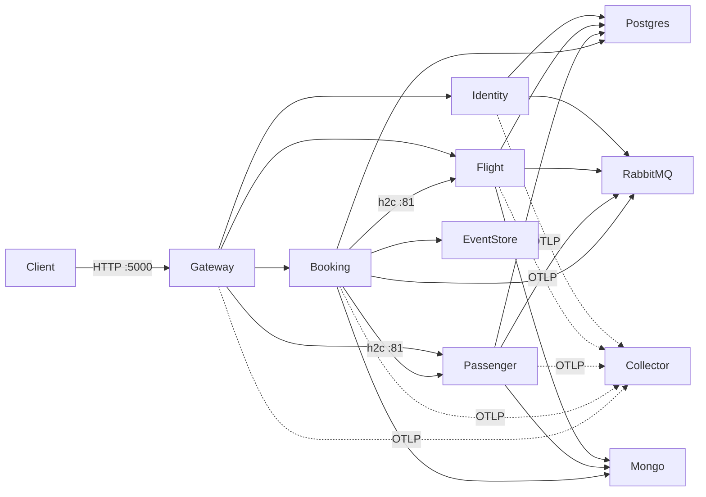

# Runbook: Docker Compose topologies

The repository supports a modular-monolith topology and a multi-service topology. Both include the same infrastructure
project and intentionally share container names and host ports. Run only one application topology at a time; stop the
current one with `down --remove-orphans` before switching.

## Topologies

### Multi-service



Start it from the repository root:

```bash
docker compose -f deployments/docker-compose/docker-compose.yaml up -d --build
docker compose -f deployments/docker-compose/docker-compose.yaml ps
scripts/smoke/compose-e2e.sh
```

### Monolith

```bash
docker compose -f deployments/docker-compose/docker-compose.monolith.yaml up -d --build
curl --fail http://localhost:5000/health
```

The `booking_modular_monolith` API is routed by the same gateway. The app environment and HTTPS certificate settings
are unchanged from the prior Compose launcher. The monolith publishes HTTP on `3001` and HTTPS on `3443`; Grafana uses
`3000`, so the complete topology, including observability, starts without a host-port conflict. To switch topologies:

```bash
docker compose -f deployments/docker-compose/docker-compose.yaml down --remove-orphans
docker compose -f deployments/docker-compose/docker-compose.monolith.yaml up -d --build
```

Use the corresponding Compose file for `down`. Avoid `down -v` unless intentionally removing local databases.

## Ports and service configuration

All application containers attach to the included `infrastructure` network and use Compose service names for service
discovery. The gateway is the only application port published on all interfaces; all other application ports are bound
to loopback for local diagnostics.

| Compose service | Image / Dockerfile | Host ports | Key runtime configuration |
|---|---|---|---|
| `gateway` | `booking-gateway` / `src/Gateway/Dockerfile` | `5000:80` | Routes Identity, Flight, Passenger, Booking to their service names; OIDC metadata via `identity-service`; OTLP to collector |
| `identity-service` | `booking-identity-service` / `src/Services/Identity.Host/Dockerfile` | `127.0.0.1:5103:80` | Public issuer and authority `http://localhost:5000`; PostgreSQL `identity_service` role/database; RabbitMQ `booking/booking` |
| `flight-service` | `booking-flight-service` / `src/Services/Flight.Host/Dockerfile` | `127.0.0.1:5107:80`, `127.0.0.1:5106:81` | PostgreSQL `flight_service`; Mongo `flight_service_read`; RabbitMQ; JWT metadata from `identity-service` |
| `passenger-service` | `booking-passenger-service` / `src/Services/Passenger.Host/Dockerfile` | `127.0.0.1:5102:80`, `127.0.0.1:5202:81` | PostgreSQL `passenger_service`; Mongo `passenger_service_read`; RabbitMQ; JWT metadata from `identity-service` |
| `booking-service` | `booking-booking-service` / `src/Services/Booking.Host/Dockerfile` | `127.0.0.1:5004:80` | PostgreSQL `booking_service`; Mongo `booking_service_read`; EventStoreDB; RabbitMQ; Flight and Passenger gRPC on `:81` |

The per-service PostgreSQL roles/passwords used by the local Compose file are `identity_service`,
`flight_service`, `passenger_service`, and `booking_service`. They are development-only credentials, not deployment
secrets. Mongo read models are isolated by service. The infrastructure Compose file also publishes ports for local
database/broker/observability tools.

## Startup and health gating

Infrastructure health checks cover PostgreSQL (`pg_isready`), MongoDB (`mongosh` ping), EventStoreDB (the image's
built-in `/health/live` check), Redis (`redis-cli ping`), and RabbitMQ (`rabbitmq-diagnostics`). Identity waits for
PostgreSQL and RabbitMQ. Flight and Passenger wait for their PostgreSQL, MongoDB, RabbitMQ, and Identity dependencies.
Booking additionally waits for EventStoreDB, Flight, and Passenger; its readiness endpoint includes downstream gRPC.
The gateway waits for all four hosts to report healthy.

App container checks use Bash's `/dev/tcp` support to issue a dependency-free HTTP GET: `/health` for Identity and the
gateway, and `/health/ready` for Flight, Passenger, and Booking. Each has a 120-second start period to allow image
startup, database initialization, and health dependencies to settle. The ASP.NET runtime image is verified to contain
Bash.

## End-to-end smoke flow

Run `scripts/smoke/compose-e2e.sh` with the service topology running. `GATEWAY` can override the default
`http://localhost:5000`. The script waits for gateway health, checks unauthenticated rejection, obtains a password-grant
token through the gateway using the seeded `samh` local account, registers a unique passenger, polls the Passenger
projection for the RabbitMQ event, completes registration, and creates a booking for the seeded Flight. It verifies the
seat reservation and the Booking Mongo read model when that database is reachable, then checks an unmatched path for
HTTP 404. Tokens are supplied to API requests through curl config input rather than command-line arguments.

## Troubleshooting

| Symptom | Action |
|---|---|
| Docker Hub returns `429 Too Many Requests` | Pull a mirror copy and retag it before retrying Compose. For example: `docker pull mirror.gcr.io/library/postgres:16 && docker tag mirror.gcr.io/library/postgres:16 postgres:16`. Use the equivalent `mirror.gcr.io/<org>/<image>:<tag>` path for public observability images; EventStoreDB's image path is `mirror.gcr.io/eventstore/eventstore:23.10.0-bookworm-slim`. |
| cAdvisor cannot bind port `8080` | Set `CADVISOR_HOST_PORT=18080` in the shell before `docker compose up`; the container still listens on `8080`. |
| PostgreSQL roles/databases are missing | `01-service-databases.sql` runs only when PostgreSQL initializes a fresh volume. Existing volumes are not modified. Do not remove a volume containing wanted data; back it up and apply an approved migration or create the missing local role/database explicitly. |
| Mongo read models are missing after recreating the container | MongoDB now stores `/data/db` in the named `mongo-data` volume, which ordinary `down` preserves. Existing anonymous Mongo volumes are not migrated automatically; preserve/copy wanted data before switching to the named volume. `down -v` deletes Mongo and PostgreSQL data volumes. |
| A topology fails because a container/port is already in use | Stop the other topology with its Compose file and `down --remove-orphans` before switching. The two topologies intentionally share names and ports. |
| Service health remains starting/unhealthy | Inspect `docker compose ... ps` and `logs <service>`. Check PostgreSQL init output, RabbitMQ credentials, MongoDB database name, EventStoreDB, and gRPC readiness dependencies. |
| Events or outbox work is duplicated | Run one replica of each service with background processing. In particular, Booking's EventStoreDB subscription and outbox worker are not configured for concurrent replicas. |
| Service image pulls are throttled | Retag the matching public mirror image as above; Compose uses normal public image names after retagging. If a mirror does not contain an image, wait for the upstream limit to reset or use an approved registry mirror. |
